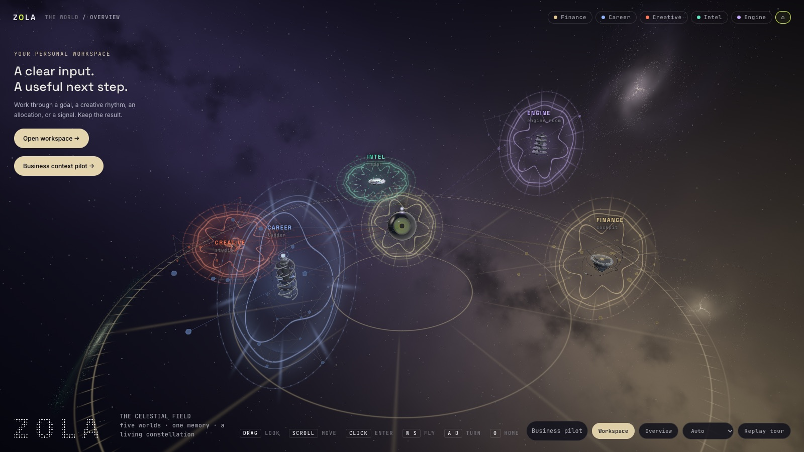
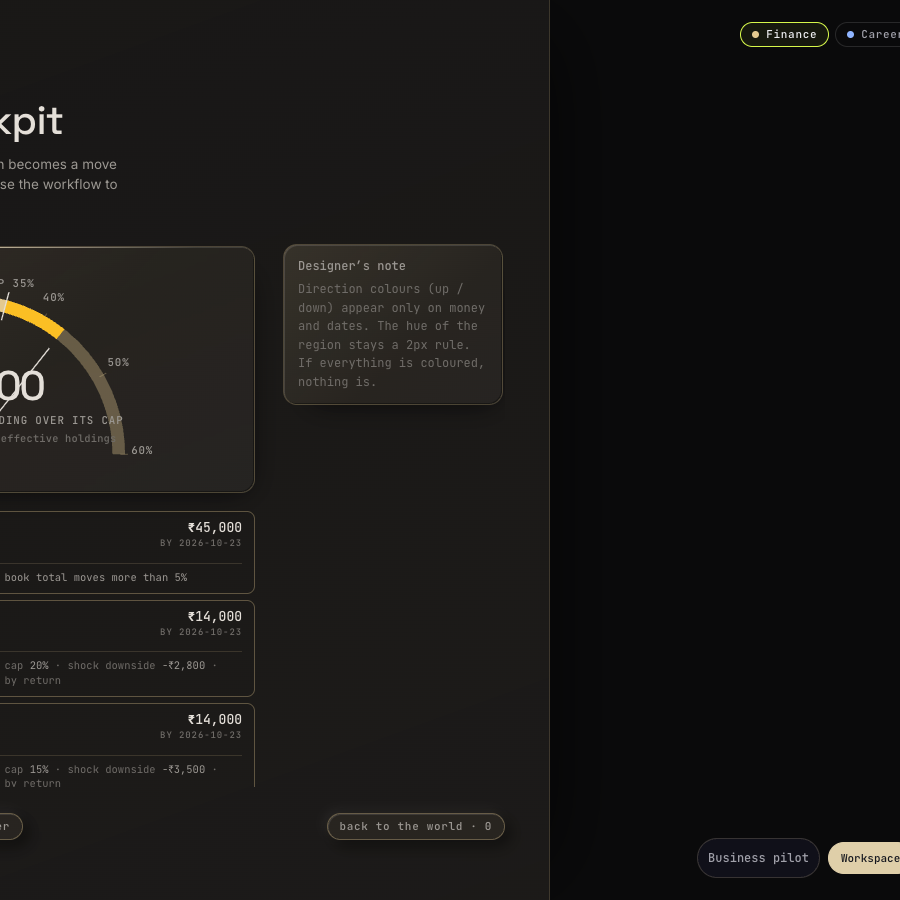
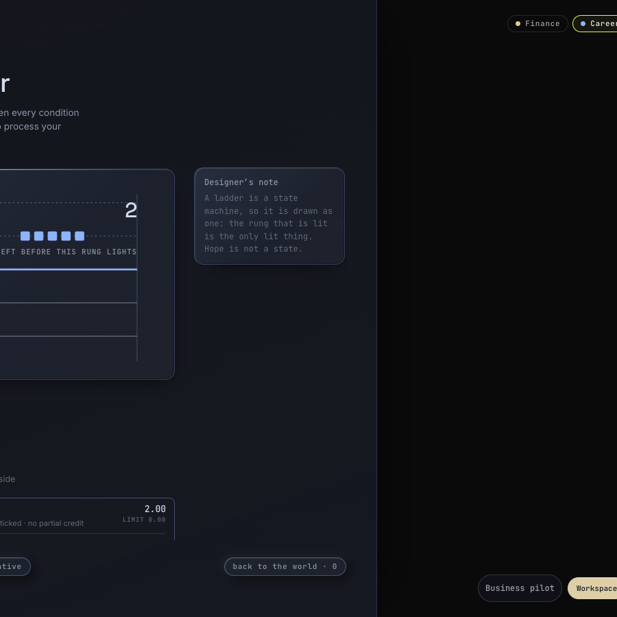
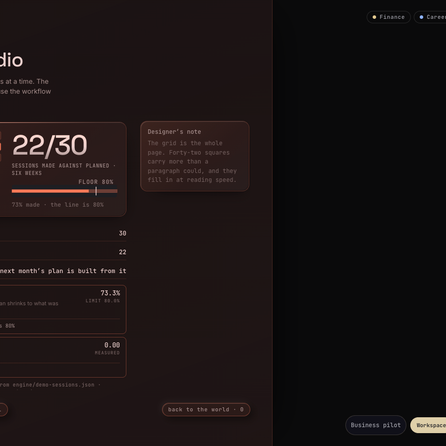
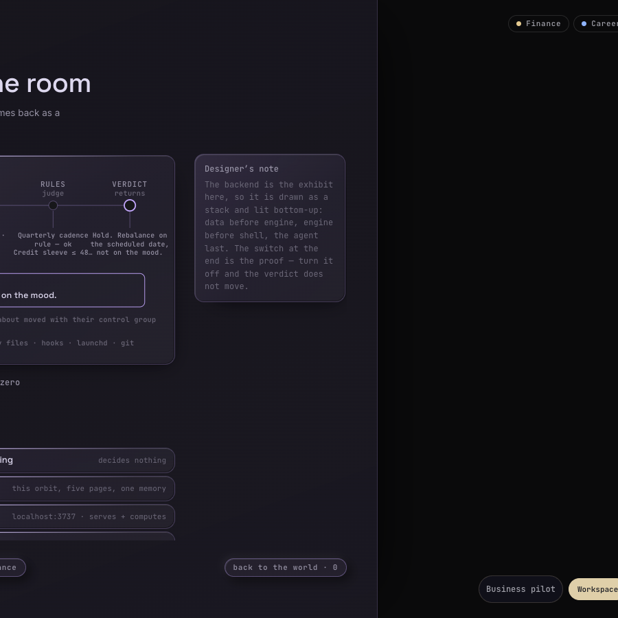
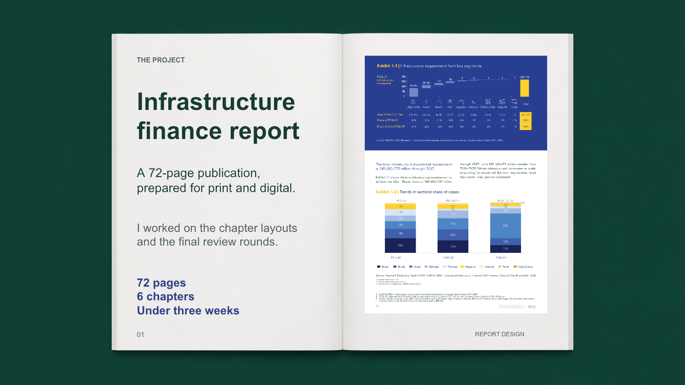

  

<h1 align="center">Portfolio</h1>

<strong>Creative technologist. I design and ship: concept, visual system, front end in code, Python engines, applied AI.</strong> 
Judge the work by what shipped.

  <a href="https://11vinaypathak-sys.github.io/zola-showoff/world.html"><strong>ZOLA, the world →</strong></a>
  &nbsp;·&nbsp; <a href="https://11vinaypathak-sys.github.io/portfolio/report/"><strong>The report, as a book →</strong></a>

---

## 1 · ZOLA: a personal operating system you can watch think

Five domains of a life in orbit around one core, each a working instrument, on a deterministic decision engine that refuses to flatter its owner. Designed and built solo, AI-assisted, in HTML, Three.js and Python. No cloud.

<table>
<tr>
<td width="50%"> <strong>Finance · the cockpit.</strong> Holdings against the caps you wrote.</td>
<td width="50%"> <strong>Career · the ladder.</strong> A rung counts only when something shipped.</td>
</tr>
<tr>
<td> <strong>Creative · the studio.</strong> Sessions as a rhythm, not a streak.</td>
<td> <strong>Engine.</strong> Ask, classify, recall, judge, verdict. Turn the agent off and the verdict does not move.</td>
</tr>
</table>

[Case study](zola/CASE-STUDY.md) · [Design law](zola/DESIGN-BRIEF.md) · [Architecture](zola/ARCHITECTURE.md) · [Source and live world](https://github.com/11vinaypathak-sys/zola-showoff)

## 2 · An infrastructure-finance report: editorial print at scale

  

A 72-page, six-chapter published report, taken from a Word manuscript to a print-ready publication in under three weeks. I designed the chapter build and ran the final comment rounds, with interim versions every two hours on the last working day before print. Shown as a seven-spread book you can turn: **[open it](https://11vinaypathak-sys.github.io/portfolio/report/)** (click, arrow keys or scroll). Page artwork is from the public published report.

## 3 · Klack: a macOS keyboard-sound app, shipped v1.0

Every keypress plays a real recorded switch sample, rendered from a panel drawn in code, not screen-recorded. Licensed audio only. [Case study](klack/CASE-STUDY.md) · [README](klack/README.md) · source available on request.

## 4 · Ring and Shift: macOS utilities in Swift

Ring is a liquid-glass circle dock with Dock-style magnification; Shift is its sibling. [README](ring/README.md).

## 5 · Day tracker: a daily and goal tracker with evidence-based load engines

Training-load and adherence engines (ACWR, MacroFactor-style adjustment) behind a plain local UI. [README](daytracker/README.md).

---

## How I work

**Deterministic core, agentic shell.** Rules are code you can audit; the model proposes and never decides.
**Design in code.** Flat UI, lightness-stepped surfaces, one accent, every text pair measured to WCAG AA.
**Measure every claim.** A render harness for stills, a check before every push, no number without a source.

Everything here was built solo with AI assistance, end to end. Textures CC0 (Poly Haven). Client work shows only what the client published.
